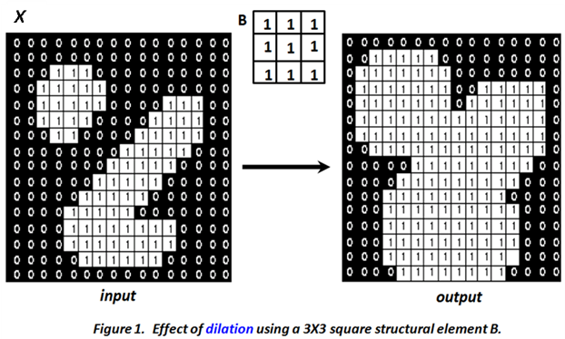
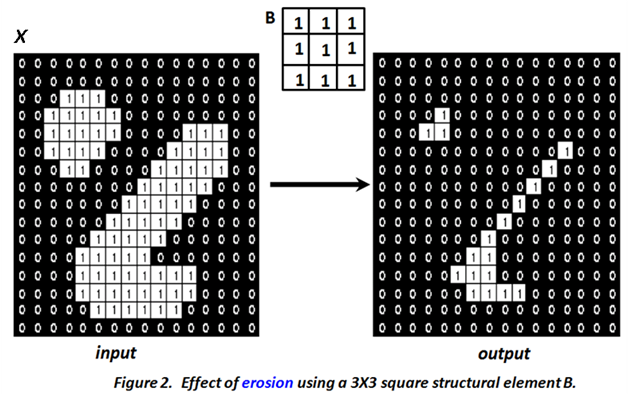
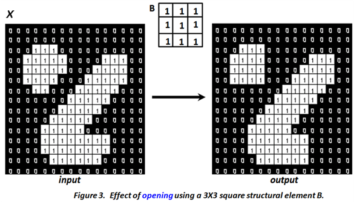
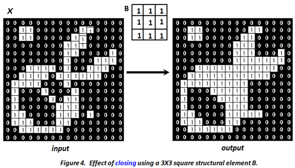

Mathematical morphology is an area of image processing concerned with analysing and modifying the **shape, structure, and spatial relationships of objects** in an image. Morphological operations are especially useful when the information of interest is related to the form of objects rather than only their individual pixel intensities.

In the **Morphological Operations experiment**, you will study how a small pattern called a **structuring element** interacts with an image to modify object shapes. The experiment focuses on the fundamental morphological operations of **dilation, erosion, opening, and closing**, and on understanding how the shape and size of the structuring element affect their results.

Morphological operations were originally developed for binary images, where an image can be viewed as a set of foreground pixels. They were later extended to grayscale images, where the operations are defined using local maximum and minimum values.

### Structuring Element

A **structuring element** is a small matrix or pattern that is used to examine the neighbourhood of each pixel or location in an image. It is similar in appearance to a mask used in neighbourhood operations, but morphological operations are based on the geometric relationship between the structuring element and the image.

The **shape**, **size**, and spatial arrangement of the structuring element determine how the objects in the image are modified.

For example, a square structuring element can be used when the features of interest have approximately square or general shapes, while circular or oriented structuring elements may be more suitable when the geometry of the objects has a particular form.

In the examples used in this experiment, a \(3\times3\) square structuring element is used:

$$
B =
\begin{bmatrix}
1 & 1 & 1 \\
1 & 1 & 1 \\
1 & 1 & 1
\end{bmatrix}
$$

The centre of the structuring element is treated as its reference or local origin. As the structuring element is moved across the image, its relationship with the foreground pixels determines the output.

The size of the structuring element is also important. A larger structuring element generally produces a stronger morphological effect, while a smaller structuring element is more suitable for preserving finer structures.

### Binary Morphological Operations

For a binary image, the foreground pixels can be considered as a set \(X\), while the structuring element is represented by a set \(B\). Morphological operations use set-theoretic relationships between these two sets.

The four basic morphological operations studied in this experiment are:

1. Dilation
2. Erosion
3. Opening
4. Closing

Dilation and erosion are the fundamental operations. Opening and closing are combinations of these two operations.

### Dilation

**Dilation** expands or enlarges foreground objects in a binary image. It adds foreground pixels around existing objects according to the shape and size of the structuring element.

The dilation of a set \(X\) by a structuring element \(B\) can be expressed as

$$
X \oplus B =
\left\{
x \mid (-B)_x \cap X \neq \varnothing
\right\}
$$

Here, \(X\) represents the foreground object and \(B\) represents the structuring element. The notation \((-B)\_x\) represents the reflected structuring element translated to the location \(x\).

In simple terms, a location becomes part of the dilated object when the structuring element, after being positioned at that location, overlaps the foreground object.

The effect of dilation can therefore be understood as **expansion of the foreground region**.

_Figure 1: Effect of dilation using a \(3\times3\) square structuring element._

The figure shows a binary input image, a \(3\times3\) square structuring element, and the resulting image after dilation. The foreground regions become larger in the output image. Narrow gaps between nearby foreground regions can also become smaller or disappear when the structuring element is sufficiently large.

Thus, dilation can be used to connect nearby components, fill small gaps, and expand foreground objects.

### Erosion

**Erosion** has an effect opposite to dilation. It reduces or shrinks foreground objects by removing boundary pixels according to the shape and size of the structuring element.

The erosion of \(X\) by \(B\) is defined as

$$
X \ominus B =
\left\{
x \mid B_x \subseteq X
\right\}
$$

The condition \(B_x \subseteq X\) means that the structuring element must fit completely within the foreground object at the location \(x\).

Therefore, a location remains part of the eroded object only when the structuring element is completely contained within the original foreground region.

_Figure 2: Effect of erosion using a \(3\times3\) square structuring element._

The figure shows that erosion decreases the size of the foreground objects. Thin portions of an object may disappear, narrow connections may be broken, and small foreground regions may be removed.

The extent of erosion depends on the size and shape of the structuring element. A larger structuring element generally produces greater shrinking of the foreground regions.

### Dilation and Erosion: Comparison

Dilation and erosion can be understood as complementary operations.

| Operation | Main effect                                           |
| --------- | ----------------------------------------------------- |
| Dilation  | Expands foreground objects                            |
| Erosion   | Shrinks foreground objects                            |
| Dilation  | Can fill small gaps and connect nearby regions        |
| Erosion   | Can remove small regions and break narrow connections |

The actual result depends on the structuring element. Therefore, the same image can produce different results when different structuring elements are used.

### Opening

**Opening** is obtained by applying erosion followed by dilation using the same structuring element.

It is defined as

$$
X \circ B =
(X \ominus B) \oplus B
$$

The first erosion removes small structures and thin connections. The subsequent dilation restores much of the size of the remaining larger structures.

_Figure 3: Effect of opening using a \(3\times3\) square structuring element._

The figure illustrates how opening modifies the shape of the foreground objects. Small protrusions and thin connections can be removed while larger structures are largely retained.

Opening is therefore useful for **removing small foreground structures, eliminating thin protrusions, and smoothing object boundaries**.

An important point is that opening is not simply another form of erosion. The dilation following erosion restores much of the size of the structures that survive the erosion.

### Closing

**Closing** is obtained by applying dilation followed by erosion using the same structuring element.

It is defined as

$$
X \bullet B =
(X \oplus B) \ominus B
$$

The initial dilation expands the foreground regions and can fill small gaps or narrow breaks. The subsequent erosion reduces the expanded regions while retaining the larger structures.

_Figure 4: Effect of closing using a \(3\times3\) square structuring element._

The figure shows how closing modifies the input object by filling small gaps and narrow breaks while generally preserving the larger structure.

Closing is therefore useful for **filling small holes or gaps, joining nearby regions, and smoothing object boundaries**.

### Opening and Closing: Comparison

Opening and closing use the same two basic operations but in opposite orders.

$$
\text{Opening}:
\quad
X \ominus B
\rightarrow
X \oplus B
$$

$$
\text{Closing}:
\quad
X \oplus B
\rightarrow
X \ominus B
$$

The difference in ordering produces different effects:

- **Opening** tends to remove small foreground structures, thin protrusions, and narrow connections.
- **Closing** tends to fill small holes, gaps, and narrow breaks in foreground structures.

The effect of both operations depends on the size and shape of the structuring element.

### Choice of Structuring Element

The structuring element is one of the most important factors in morphological processing. Its **shape** determines the type of geometric features that are favoured or suppressed, while its **size** determines the scale of the features affected by the operation.

For example, a circular structuring element can be useful when the objects of interest have approximately circular shapes. An oriented structuring element can be useful when the image contains elongated structures with a particular direction.

The size should be selected according to the size of the features of interest. A small structuring element is generally more suitable for fine structures, whereas a larger structuring element produces stronger changes and can affect larger regions.

Therefore, selecting a suitable structuring element is an important part of applying morphological operations effectively.

### Extension to Grayscale Images

Although binary morphology provides a simple set-theoretic interpretation, morphological operations can also be applied to grayscale images.

For a grayscale image, the pixel values belong to a range of intensity levels rather than simply representing foreground and background sets. Morphological operations are therefore defined using local extrema.

For grayscale dilation, the output value at a location is determined by the **maximum** value within the neighbourhood defined by the structuring element.

For grayscale erosion, the output value is determined by the **minimum** value within the corresponding neighbourhood.

Thus, in simplified form,

$$
g_{\text{dilation}}(x,y)
=
\max_{(u,v)\in B}
f(x-u,y-v)
$$

and

$$
g_{\text{erosion}}(x,y)
=
\min_{(u,v)\in B}
f(x+u,y+v)
$$

where \(f(x,y)\) is the input grayscale image and \(B\) defines the neighbourhood considered by the structuring element.

The important idea is that binary morphology is based on set relationships, whereas grayscale morphology uses local intensity extrema.

### Morphological Operations and Object Shape

Morphological operations are particularly useful when the shape and structure of objects are important.

Dilation can make objects larger and can connect nearby components. Erosion can make objects smaller and can remove small structures. Opening can remove small foreground features while preserving larger objects, whereas closing can fill small gaps and holes while preserving larger structures.

These operations are therefore useful in tasks such as shape analysis, object extraction, boundary modification, and preparation of binary or grayscale images for further processing.

The effect should always be interpreted relative to the selected structuring element. A feature that is smaller than the effective scale of the structuring element may be removed or altered, while larger structures are more likely to be preserved.

### What to Observe in the Morphological Operations Experiment

In this experiment, observe how changing the morphological operation and the structuring element affects the shape of the objects in the image.

In particular, observe:

- how **dilation** expands foreground objects;
- how dilation can reduce small gaps and connect nearby foreground regions;
- how **erosion** shrinks foreground objects;
- how erosion can remove small foreground regions and break narrow connections;
- how **opening** removes small foreground structures and thin protrusions;
- how **closing** fills small gaps, holes, and narrow breaks;
- how the order of erosion and dilation distinguishes opening from closing;
- how the **size of the structuring element** affects the strength of the operation;
- how the **shape of the structuring element** influences the geometric features affected by the operation; and
- how the interpretation changes when morphological operations are applied to grayscale images rather than binary images.

These observations connect the mathematical definitions of the morphological operations with their visible effects on image structures.

### Understanding the Morphological Operations Experiment

Morphological operations provide a way to analyse and modify image structures using a structuring element. Their behaviour is determined not only by the operation itself but also by the shape and size of the structuring element.

The fundamental operations are dilation and erosion. Dilation expands foreground regions, while erosion shrinks them. Opening combines erosion followed by dilation and is useful for removing small foreground structures. Closing combines dilation followed by erosion and is useful for filling small gaps and holes.

For binary images, these operations can be understood using set-theoretic relationships. For grayscale images, the corresponding operations are based on local maximum and minimum values.

The key idea of the **Morphological Operations experiment** is that the shape and size of image structures can be modified systematically by choosing an appropriate morphological operation and structuring element. By observing the results of dilation, erosion, opening, and closing, you can understand how local geometric processing changes the structure of objects in an image.
